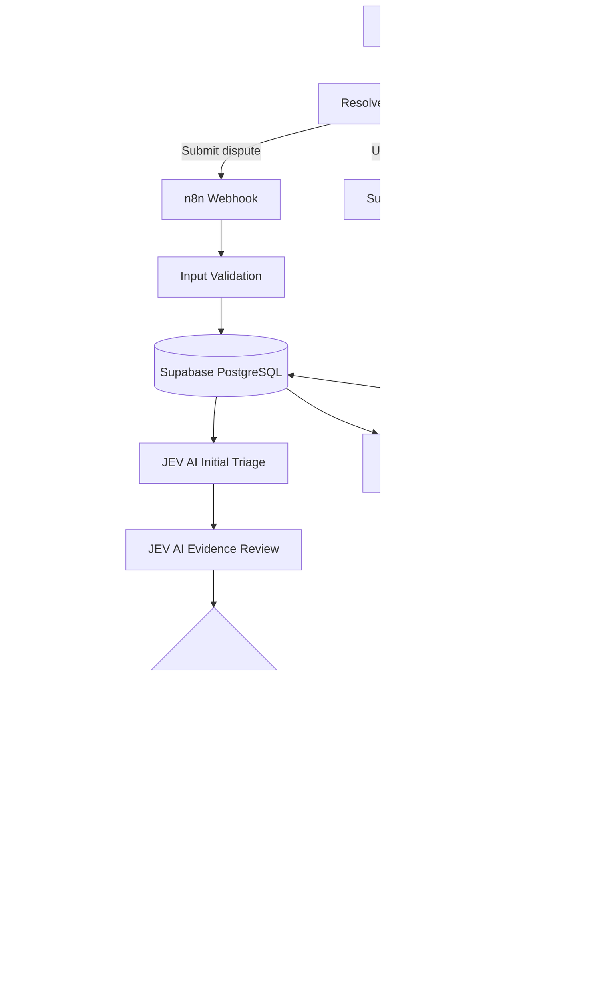

# ResolveAI — AI-Assisted Merchant Payment Dispute Resolution

ResolveAI is a merchant-facing application that helps merchants submit, manage, and track payment-related disputes. It combines a web-based merchant interface, Supabase for persistent data and evidence storage, and n8n for workflow orchestration and AI-assisted processing.

> **Project status:** Hackathon prototype. ResolveAI assists with dispute intake, evidence review, and case workflow management. It does not independently confirm settlement or move funds. Production-grade transaction verification would require authorized integration with Paytm/payment-system transaction APIs.

## Problem Statement

Merchants can encounter payment discrepancies such as:
- A customer reports that money was debited, but the merchant cannot see the payment.
- A transaction is failed, pending, or has an unclear status.
- The amount or transaction details appear inconsistent.
- Merchants need to submit screenshots and other supporting information but have limited visibility into the complaint's progress.

Handling these issues can involve manual evidence collection, repeated follow-ups, and fragmented case information. Merchants need a clear way to raise a dispute and follow its processing status.

## Solution

ResolveAI provides a centralized merchant-facing workflow to:
1. Submit a payment-related issue with order/transaction details, amount, description, and supporting evidence.
2. Create a structured dispute case and retain its associated information.
3. Use AI-assisted triage and evidence review to help classify the issue and assess the submitted material.
4. Route cases through workflow branches according to verification outputs and configured rules.
5. Persist case updates so the merchant interface can display the latest available status.

The goal is to reduce repetitive manual handling and improve visibility and consistency in merchant dispute management.

## Technology Stack

| Layer | Technology | Responsibility |
|---|---|---|
| Frontend | React, JavaScript, Vite, CSS | Merchant interface and dispute submission/tracking views |
| Database | Supabase (PostgreSQL) | Merchant, dispute, verification, and case-event data |
| File storage | Supabase Storage | Uploaded screenshots and supporting evidence |
| Workflow orchestration | n8n Cloud | Webhook intake, validation, AI steps, conditional routing, and database updates |
| AI service | JEV AI | AI-assisted initial triage and payment-evidence review in the configured workflow |
| Integration | n8n Webhooks, Supabase client/API | Communication between frontend, workflows, database, and storage |
| UI utilities | lucide-react | Interface icons |

## System Architecture

The frontend is the merchant interaction layer. n8n orchestrates the dispute-processing workflow. Supabase stores structured case data and supporting evidence.



The diagram represents the intended configured workflow at a high level. Exact branch conditions and status names are determined by the deployed n8n workflow.

## n8n Workflow Architecture

n8n acts as the workflow orchestration layer rather than the merchant-facing application itself.

### Processing stages

1. **Webhook intake** — receives the dispute submission from the frontend.
2. **Input validation** — checks required fields and the structure of the incoming request.
3. **Case creation / lookup** — creates or retrieves the relevant case record in Supabase and associates the evidence reference.
4. **Initial AI triage** — JEV AI analyses the submitted issue information and assists with identifying the dispute category and relevant details.
5. **Evidence review** — the configured JEV AI verification step reviews the submitted payment evidence in the context of the dispute.
6. **Conditional routing** — n8n uses the workflow result and configured rules to direct the case to the appropriate processing or review path.
7. **Persistence and event logging** — case status and processing information are written back to Supabase.
8. **Status visibility** — the frontend retrieves persisted case information for merchant tracking.

**Important:** AI analysis of a screenshot is an assessment of submitted evidence, not proof that a payment was settled. A definitive payment-status decision requires an authoritative transaction lookup through an authorized payment-system API. ResolveAI's prototype should not be interpreted as performing that lookup unless such an integration is added.

## Frontend Architecture

The frontend is implemented with **React 19 and Vite**. It provides the merchant-facing experience and connects to the backend services.

Main responsibilities:
- Present the merchant interface and dispute submission form.
- Collect transaction/order details, amount, issue description, and supporting evidence.
- Upload evidence to Supabase Storage and use the resulting reference in the dispute workflow.
- Submit dispute information to the configured n8n webhook.
- Retrieve and display persisted case information and status.

The frontend is organized under `frontend/`, with application code in `frontend/src/`. Supabase client and service modules are kept separate from the main UI components.

## Database and Evidence Storage

**Supabase PostgreSQL** stores structured application data, including dispute records and case-processing information.

**Supabase Storage** stores uploaded evidence files. The application uses a storage path/reference to associate evidence with its dispute case rather than treating the file itself as a database record.

Access policies and Row Level Security should be configured for the production deployment so merchants can access only records and files they are authorized to view.

## Run the Frontend Locally

### Prerequisites
- Node.js (a version compatible with the installed Vite version)
- npm
- Supabase project credentials
- n8n webhook URL for end-to-end submission testing

### Setup

```bash
git clone https://github.com/Bkanaiya/ResolveAI.git
cd ResolveAI/frontend
npm install
```

Configure the environment variables expected by the frontend's Supabase and webhook service modules. Do not commit API keys, service-role keys, or private credentials. Use the variable names defined in the project code and keep local values in an ignored `.env` file.

Start the development server:

```bash
npm run dev
```

Create a production build:

```bash
npm run build
```

Run lint checks:

```bash
npm run lint
```

## Security Notes

- Never expose Supabase service-role keys or private AI/API credentials in browser code.
- Validate webhook input server-side in the workflow.
- Apply Supabase Row Level Security and storage policies before handling real merchant data.
- Treat uploaded screenshots as untrusted user-provided evidence.
- Do not make refund, settlement, or payment-finality decisions solely from AI-generated analysis.

## Future Scope

- Authorized integration with Paytm transaction-status and settlement APIs.
- Stronger evidence consistency checks and exception handling.
- Merchant notifications when case status changes.
- Operational analytics for dispute categories and processing outcomes.
- Role-based access and production-grade audit controls.

## Project Vision

ResolveAI aims to make payment dispute handling more organized and transparent for merchants by combining a simple merchant interface, AI-assisted evidence review, and automated workflow orchestration.
